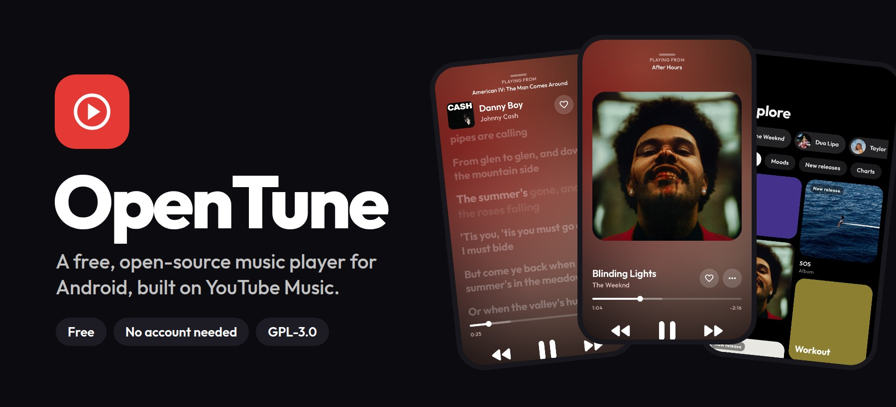
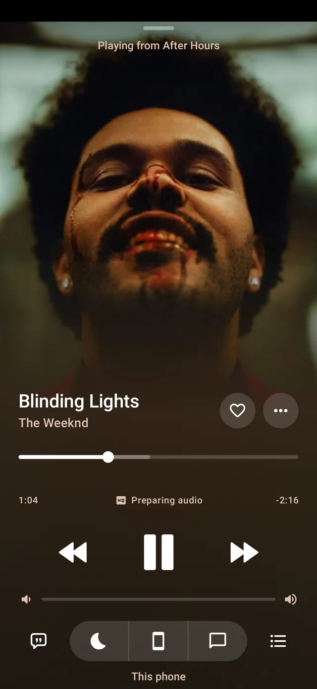
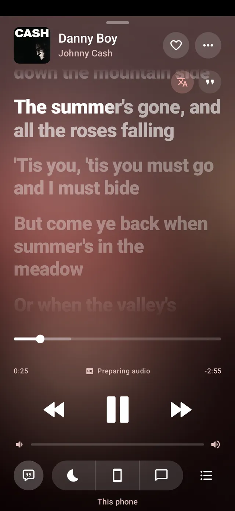
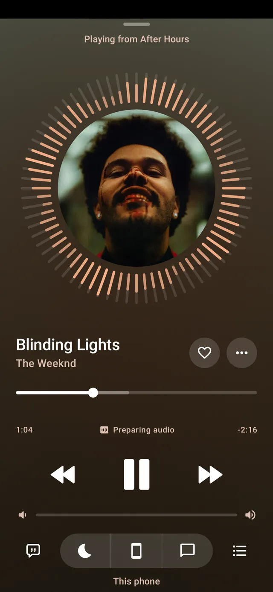
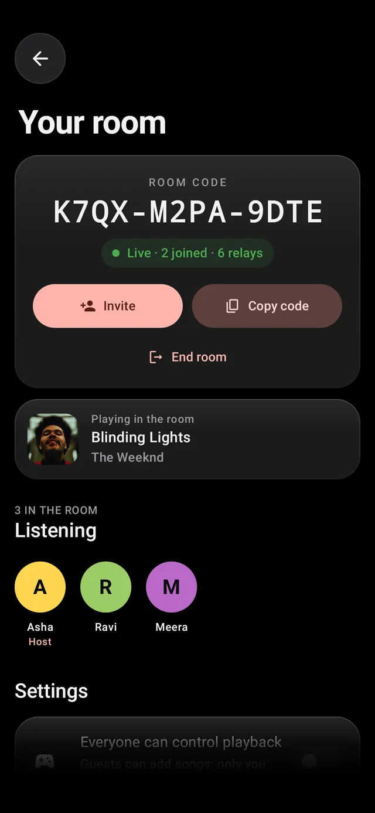
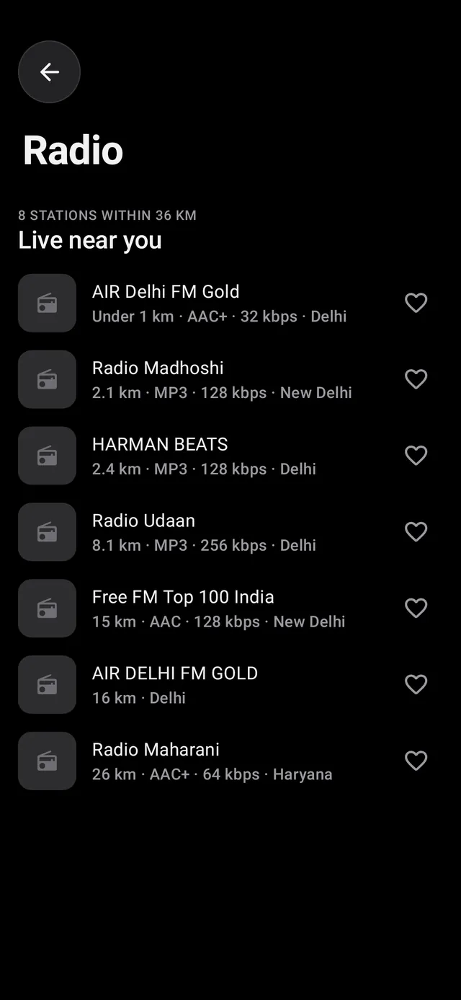

<p align="center">
  
</p>

<p align="center">
  <a href="https://github.com/justshivv/Opentune/releases/latest"><b>Download</b></a>
  &nbsp;·&nbsp;
  <a href="https://justshivv.github.io/Opentune/">Website</a>
  &nbsp;·&nbsp;
  <a href="https://justshivv.github.io/Opentune/player/">Web player</a>
  &nbsp;·&nbsp;
  <a href="docs/features.md">Features</a>
  &nbsp;·&nbsp;
  <a href="https://discord.gg/6udrCVh5n">Discord</a>
</p>

<p align="center">
  <a href="https://github.com/justshivv/Opentune/actions/workflows/ci.yml"></a>
  
  
  <a href="LICENSE"></a>
  <a href="https://justshivv.github.io/Opentune/usage/"></a>
  <a href="https://justshivv.github.io/Opentune/usage/"></a>
  <a href="https://justshivv.github.io/Opentune/usage/"></a>
</p>

<p align="center">
  <a href="https://trendshift.io/repositories/311235?utm_source=trendshift-badge&amp;utm_medium=badge&amp;utm_campaign=badge-trendshift-311235" target="_blank" rel="noopener noreferrer"></a>
  <a href="https://trendshift.io/repositories/311235?utm_source=repository-badge&amp;utm_medium=badge&amp;utm_campaign=badge-repository-311235" target="_blank" rel="noopener noreferrer"></a>
</p>

<p align="center">
  <a href="https://rookieenough.github.io/Orion-Data/redirect.html?id=opentune&icon=https%3A%2F%2Fjustshivv.github.io%2FOpentune%2Ficon-512.png"></a>
</p>

# OpenTune

A free music player for the YouTube Music catalogue, with no ads, no account
and no subscription. It runs on Android phones and TVs, Windows, macOS, Linux
and in the browser. Sign in only if you want your likes and playlists.

<p align="center">
  
  
  
  
  
</p>

## Get it

| Where | How |
|---|---|
| **Android phone or tablet** | Download the APK from the [latest release](https://github.com/justshivv/Opentune/releases/latest), open it and allow the install. Android 8.0 or newer. |
| **Android TV, Google TV** | Install `OpenTune-TV-<version>.apk` from the [releases](https://github.com/justshivv/Opentune/releases) and sign in by scanning a code with your phone. [More](docs/install.md#android-tv) |
| **Windows, macOS, Linux** | Desktop builds are attached to the [latest release](https://github.com/justshivv/Opentune/releases/latest). |
| **Browser** | Open the [web player](https://justshivv.github.io/Opentune/player/). It needs a small companion extension. [More](docs/install.md#web-player-preview) |
| **iPhone, iPad** (early build) | Through SideStore or AltStore, with your own Apple ID. [Steps](docs/install.md#iphone-and-ipad) |

On Android, `arm64-v8a` fits almost every recent phone and `universal` runs on
anything. Each release lists the SHA-256 checksums of its files, and the app
checks for updates once a day and can update itself.

## What it does

**Listening**
- Plays the best stream it can find, and upgrades mid-song without a gap.
- Crossfade and Automix, loudness levelling, a 15-band equalizer and AutoEq
  corrections for more than 8,000 headphones.
- Bit-perfect output to a USB DAC on Android 14 and newer.
- Lossless audio from add-ons you choose to connect. [How add-ons work](docs/audio-addons.md)
- Offline downloads, and the music files already on your phone.

**Lyrics**
- Synced lyrics lit word by word, from several sources, that also work offline.
- Tap a line to jump there, or share the lines you love as a picture or a video.

**Beyond music**
- Live radio from more than 50,000 stations, nearest first.
- Podcasts and audiobooks that pick up where you stopped.
- Listen together: share a room code and friends hear the same song in step.

**Your library**
- Likes, playlists, smart playlists, daily mixes and Replay stories.
- Import from Spotify and YouTube playlists; scrobble to Last.fm and ListenBrainz.
- Your own music server (Subsonic).

**Look and feel**
- A player that takes its colours from the cover, in seven layouts, from a
  full-screen cover to vinyl, cassette and a glowing halo.
- Light, dark and pure black themes, accent colours, Liquid Glass, and
  36 languages.

**Around the phone**
- Cast to Chromecasts, TVs and network speakers; Android Auto; a home-screen widget.
- Name that song: hold the phone up and it tells you what's playing.
- Your phone as the remote for the TV app.

The full list, with how each part works, is in [docs/features.md](docs/features.md).

## Documentation

| | |
|---|---|
| [Features](docs/features.md) | Everything the app does, in detail |
| [Installing](docs/install.md) | iPhone and iPad, Android TV and the web player, step by step |
| [Audio add-ons](docs/audio-addons.md) | Connecting your own lossless sources |
| [Android TV](docs/android-tv.md) | The TV app and the phone remote |
| [Appearance options](docs/appearance-options.md) | Themes, layouts and glass |
| [Languages](docs/languages.md) | Translations and how to add one |
| [Service integrations](docs/service-integrations.md) | Last.fm, Discord and build-owner setup |
| [Usage counts](docs/usage-counts.md) | What the app reports, and what it never does |
| [Building](docs/building.md) | Building from source, CI, releases and the project layout |

## Build it yourself

```
./gradlew assembleDebug        # app/build/outputs/apk/debug/
./gradlew testDebugUnitTest    # unit tests
```

You need JDK 17 or newer and an Android SDK with platform 37. Details, release
signing and the project layout are in [docs/building.md](docs/building.md).

## Privacy

OpenTune has no ads and needs no account. Usage counting sends a random
installation ID, the app version and daily play totals; never song names,
accounts or listening history. You can turn it off under Settings › About.
[What is counted](docs/usage-counts.md) · [Privacy policy](https://justshivv.github.io/Opentune/privacy/)

## Community

Questions, ideas and bug reports are welcome on
[Discord](https://discord.gg/6udrCVh5n) and in the
[issues](https://github.com/justshivv/Opentune/issues).

## Disclaimer

The screenshots show real albums, artists and songs to show the app as it's
used. Cover art, names and recordings belong to their owners. OpenTune isn't
affiliated with or endorsed by YouTube, Google, Spotify or any artist or label
shown.

## License

OpenTune is licensed under the GNU General Public License v3.0. See
[LICENSE](LICENSE). Code, libraries, fonts and data from other projects are
listed in [THIRD_PARTY_NOTICES.md](THIRD_PARTY_NOTICES.md), as their licences
require.
